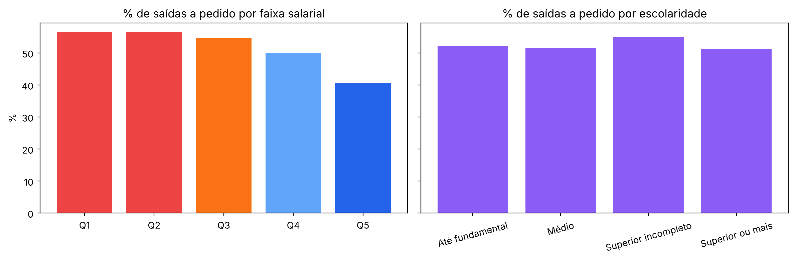

# Raio-X do Mercado de Trabalho Industrial de Santa Catarina
**Equipe Kirasapiens Neurotech · Datathon UniSENAI 2026 · consultoria de dados para a FIESC**

> **Pergunta central:** quais regiões e setores industriais de SC enfrentam apagão de mão de obra ou expansão acelerada, e como renda e escolaridade explicam esses gargalos?

Este notebook documenta **todo o pipeline**, da carga inicial e exclusão de registros inválidos até a comunicação com a IA e a exportação final que alimenta o painel (`dashboard/app.py`). O código reutilizável está em `backend/`.

| Etapa do guia | Onde está neste notebook | Código |
|---|---|---|
| Ingestão e validação (schema, inconsistências, MOV × EXC) | Seção 1 | `backend/validacao.py`, `backend/pipeline.py` |
| Cruzamento relacional (CAGED × IBGE) e saldo por 10 mil hab. | Seção 2 | `backend/pipeline.py` |
| Enriquecimento com IA (prompt, amostra, API, importação) | Seção 3 | `backend/cbo_llm.py`, `data/ia/` |
| Análise: indicadores, diagnóstico e robustez | Seção 4 | `backend/indicadores.py`, `backend/estatistica.py` |
| Renda e escolaridade | Seção 5 | `backend/estatistica.py` |
| Exportação final | Seção 6 | `backend/exportar.py` |


```python
import sys; sys.path.insert(0, '../backend')
import pandas as pd, numpy as np
import matplotlib.pyplot as plt
import pipeline, validacao, cbo_llm, estatistica, exportar
pd.set_option('display.max_columns', 30); pd.set_option('display.width', 200)
P = '../data/processed/'
```

## 1. Ingestão e validação
### 1.1 Carga e schema
O arquivo `raw/Novo_Caged_MOV_Limpo.csv` (~413 MB, separador `;`, decimal `,`) não está no Git; o link do Kaggle está no README. Na primeira execução o pipeline converte o CSV para parquet (`data/processed/caged_raw.parquet`) para acelerar as demais.


```python
caged_csv = pipeline.RAW / 'Novo_Caged_MOV_Limpo.csv'
cache = pipeline.OUT / 'caged_raw.parquet'
if cache.exists():
    bruto = pd.read_parquet(cache)
elif caged_csv.exists():
    bruto = pd.read_csv(caged_csv, sep=';', decimal=',', low_memory=False)
    bruto = bruto.drop(columns=[c for c in bruto.columns if c.startswith('Unnamed')])
else:
    bruto = None
    print('CAGED bruto ausente: baixe do Kaggle (link no README) e coloque em raw/. '
          'As seções seguintes usam os arquivos processados já versionados.')
if bruto is not None:
    print(f'{len(bruto):,} registros · {bruto.shape[1]} colunas')
    display(bruto.dtypes.to_frame('tipo').T)
```

    3,397,416 registros · 28 colunas


<div>
<style scoped>
    .dataframe tbody tr th:only-of-type {
        vertical-align: middle;
    }

    .dataframe tbody tr th {
        vertical-align: top;
    }

    .dataframe thead th {
        text-align: right;
    }
</style>
<table border="1" class="dataframe">
  <thead>
    <tr style="text-align: right;">
      <th></th>
      <th>competênciamov</th>
      <th>região</th>
      <th>uf</th>
      <th>município</th>
      <th>seção</th>
      <th>subclasse</th>
      <th>saldomovimentação</th>
      <th>cbo2002ocupação</th>
      <th>categoria</th>
      <th>graudeinstrução</th>
      <th>idade</th>
      <th>horascontratuais</th>
      <th>raçacor</th>
      <th>sexo</th>
      <th>tipoempregador</th>
      <th>tipoestabelecimento</th>
      <th>tipomovimentação</th>
      <th>tipodedeficiência</th>
      <th>indtrabintermitente</th>
      <th>indtrabparcial</th>
      <th>salário</th>
      <th>tamestabjan</th>
      <th>indicadoraprendiz</th>
      <th>origemdainformação</th>
      <th>competênciadec</th>
      <th>indicadordeforadoprazo</th>
      <th>unidadesaláriocódigo</th>
      <th>valorsaláriofixo</th>
    </tr>
  </thead>
  <tbody>
    <tr>
      <th>tipo</th>
      <td>int64</td>
      <td>int64</td>
      <td>int64</td>
      <td>int64</td>
      <td>str</td>
      <td>int64</td>
      <td>int64</td>
      <td>int64</td>
      <td>int64</td>
      <td>int64</td>
      <td>float64</td>
      <td>float64</td>
      <td>int64</td>
      <td>int64</td>
      <td>int64</td>
      <td>int64</td>
      <td>int64</td>
      <td>int64</td>
      <td>int64</td>
      <td>int64</td>
      <td>float64</td>
      <td>int64</td>
      <td>int64</td>
      <td>int64</td>
      <td>int64</td>
      <td>int64</td>
      <td>int64</td>
      <td>float64</td>
    </tr>
  </tbody>
</table>
</div>


### 1.2 Validação de schema e domínios
Cada coluna obrigatória é conferida quanto à presença e ao tipo, e cada código é comparado ao **dicionário de dados oficial** (`raw/Dicionario_de_dados.xlsx`). A coluna `status` diz o que aconteceu com cada inconsistência.


```python
mun = pipeline.carregar_municipios()
if bruto is not None:
    val = validacao.validar_schema(bruto, set(mun['cod_ibge']))
else:
    val = pd.read_csv(P + 'validacao_schema.csv')
val
```


<div>
<style scoped>
    .dataframe tbody tr th:only-of-type {
        vertical-align: middle;
    }

    .dataframe tbody tr th {
        vertical-align: top;
    }

    .dataframe thead th {
        text-align: right;
    }
</style>
<table border="1" class="dataframe">
  <thead>
    <tr style="text-align: right;">
      <th></th>
      <th>regra</th>
      <th>registros</th>
      <th>status</th>
      <th>detalhe</th>
      <th>pct</th>
    </tr>
  </thead>
  <tbody>
    <tr>
      <th>0</th>
      <td>Colunas obrigatórias presentes</td>
      <td>0</td>
      <td>ok</td>
      <td>19 colunas</td>
      <td>0.000000</td>
    </tr>
    <tr>
      <th>1</th>
      <td>Tipo numérico em 'idade'</td>
      <td>2202</td>
      <td>aviso</td>
      <td>0 não numéricos, 2202 nulos</td>
      <td>0.000648</td>
    </tr>
    <tr>
      <th>2</th>
      <td>Domínio de 'uf' conforme dicionário</td>
      <td>0</td>
      <td>ok</td>
      <td>28 códigos válidos no dicionário</td>
      <td>0.000000</td>
    </tr>
    <tr>
      <th>3</th>
      <td>Domínio de 'seção' conforme dicionário</td>
      <td>0</td>
      <td>ok</td>
      <td>22 códigos válidos no dicionário</td>
      <td>0.000000</td>
    </tr>
    <tr>
      <th>4</th>
      <td>Domínio de 'categoria' conforme dicionário</td>
      <td>0</td>
      <td>ok</td>
      <td>10 códigos válidos no dicionário</td>
      <td>0.000000</td>
    </tr>
    <tr>
      <th>5</th>
      <td>Domínio de 'graudeinstrução' conforme dicionário</td>
      <td>0</td>
      <td>ok</td>
      <td>13 códigos válidos no dicionário</td>
      <td>0.000000</td>
    </tr>
    <tr>
      <th>6</th>
      <td>Domínio de 'sexo' conforme dicionário</td>
      <td>0</td>
      <td>ok</td>
      <td>3 códigos válidos no dicionário</td>
      <td>0.000000</td>
    </tr>
    <tr>
      <th>7</th>
      <td>Domínio de 'tipomovimentação' conforme dicionário</td>
      <td>0</td>
      <td>ok</td>
      <td>18 códigos válidos no dicionário</td>
      <td>0.000000</td>
    </tr>
    <tr>
      <th>8</th>
      <td>Domínio de 'cbo2002ocupação' conforme dicionário</td>
      <td>2117</td>
      <td>aviso</td>
      <td>2778 códigos válidos no dicionário; códigos CB...</td>
      <td>0.000623</td>
    </tr>
    <tr>
      <th>9</th>
      <td>Domínio de 'tamestabjan' conforme dicionário</td>
      <td>0</td>
      <td>ok</td>
      <td>14 códigos válidos no dicionário</td>
      <td>0.000000</td>
    </tr>
    <tr>
      <th>10</th>
      <td>UF = 42 (Santa Catarina)</td>
      <td>0</td>
      <td>ok</td>
      <td>fora do escopo</td>
      <td>0.000000</td>
    </tr>
    <tr>
      <th>11</th>
      <td>Saldo da movimentação em {-1, +1}</td>
      <td>0</td>
      <td>ok</td>
      <td>inconsistente</td>
      <td>0.000000</td>
    </tr>
    <tr>
      <th>12</th>
      <td>Município existe na base do IBGE</td>
      <td>0</td>
      <td>ok</td>
      <td>sem chave de junção</td>
      <td>0.000000</td>
    </tr>
    <tr>
      <th>13</th>
      <td>Categoria identificada (≠ 999)</td>
      <td>510</td>
      <td>tratado</td>
      <td>removido no pipeline</td>
      <td>0.000150</td>
    </tr>
    <tr>
      <th>14</th>
      <td>Tipo de movimentação identificado (≠ 99)</td>
      <td>0</td>
      <td>ok</td>
      <td>removido no pipeline</td>
      <td>0.000000</td>
    </tr>
    <tr>
      <th>15</th>
      <td>Idade entre 14 e 90 anos</td>
      <td>2216</td>
      <td>tratado</td>
      <td>mantido; idade não entra nos índices</td>
      <td>0.000652</td>
    </tr>
    <tr>
      <th>16</th>
      <td>Salário entre R$ 800 e R$ 60 mil</td>
      <td>63787</td>
      <td>tratado</td>
      <td>mantido na contagem; fora das comparações sala...</td>
      <td>0.018775</td>
    </tr>
    <tr>
      <th>17</th>
      <td>Declaração fora do prazo</td>
      <td>36940</td>
      <td>tratado</td>
      <td>mantida se a competência estiver na janela</td>
      <td>0.010873</td>
    </tr>
  </tbody>
</table>
</div>


**Leitura:** a base é toda de SC (UF 42), o saldo é sempre −1/+1 e 100% dos municípios têm correspondência no IBGE. As inconsistências são tratadas assim:
- **Categoria 999** (não identificada): removida.
- **Salário fora de R\$ 800 a R\$ 60 mil**: mantido nas contagens, mas fora das comparações salariais.
- **CBOs mais novos que o dicionário** (ex.: 142360): mantidos e classificados pelo subgrupo de 3 dígitos.

### 1.3 Exclusões MOV × EXC
O Novo CAGED publica duas bases: **MOV** (movimentações declaradas) e **EXC** (declarações que o empregador excluiu depois). O correto é remover da MOV os registros que aparecem na EXC. A função `validacao.aplicar_exclusoes()` faz esse anti-join, casando cada linha EXC com no máximo uma linha MOV idêntica. A organização forneceu **apenas a base MOV**; se um arquivo `*EXC*.csv` for colocado em `raw/`, a etapa é aplicada automaticamente.


```python
if bruto is not None:
    _, msg = validacao.aplicar_exclusoes(bruto.head(1000))
    print(msg)
```

    Base EXC não fornecida pela organização: exclusões não aplicadas (apenas MOV)


### 1.4 Pipeline completo e volumetria
Roda carga, validação, exclusões, filtros, junção, macrofamílias e indicadores, gravando tudo em `data/processed/`.


```python
if bruto is not None:
    del bruto
    pipeline.main()
pd.read_csv(P + 'log_limpeza.csv')
```

    Carga inicial (todas as seções)                          3,397,416


                                                regra  registros  status
                       Colunas obrigatórias presentes          0      ok
                             Tipo numérico em 'idade'       2202   aviso
                  Domínio de 'uf' conforme dicionário          0      ok
               Domínio de 'seção' conforme dicionário          0      ok
           Domínio de 'categoria' conforme dicionário          0      ok
     Domínio de 'graudeinstrução' conforme dicionário          0      ok
                Domínio de 'sexo' conforme dicionário          0      ok
    Domínio de 'tipomovimentação' conforme dicionário          0      ok
     Domínio de 'cbo2002ocupação' conforme dicionário       2117   aviso
         Domínio de 'tamestabjan' conforme dicionário          0      ok
                             UF = 42 (Santa Catarina)          0      ok
                    Saldo da movimentação em {-1, +1}          0      ok
                     Município existe na base do IBGE          0      ok
                       Categoria identificada (≠ 999)        510 tratado
             Tipo de movimentação identificado (≠ 99)          0      ok
                             Idade entre 14 e 90 anos       2216 tratado
                     Salário entre R$ 800 e R$ 60 mil      63787 tratado
                             Declaração fora do prazo      36940 tratado
    Base EXC não fornecida pela organização: exclusões não aplicadas (apenas MOV)
    Após exclusões MOV × EXC                                 3,397,416


    Competência dentro da janela (202509, 202608)            3,391,288


    Remove categoria/tipo de movimentação não identificados  3,390,779


    Indústria de transformação (seção C)                       835,776
     ...das quais com salário válido p/ comparações            781,353


    
    Diagnóstico região x setor:
    diagnostico
    Volume insuficiente      218
    Estável                  197
    Retração                  32
    Expansão acelerada        30
    Apagão de mão de obra     20
    Expansão sob pressão       6


<div>
<style scoped>
    .dataframe tbody tr th:only-of-type {
        vertical-align: middle;
    }

    .dataframe tbody tr th {
        vertical-align: top;
    }

    .dataframe thead th {
        text-align: right;
    }
</style>
<table border="1" class="dataframe">
  <thead>
    <tr style="text-align: right;">
      <th></th>
      <th>etapa</th>
      <th>linhas</th>
    </tr>
  </thead>
  <tbody>
    <tr>
      <th>0</th>
      <td>Carga inicial (todas as seções)</td>
      <td>3397416</td>
    </tr>
    <tr>
      <th>1</th>
      <td>Após exclusões MOV × EXC</td>
      <td>3397416</td>
    </tr>
    <tr>
      <th>2</th>
      <td>Competência dentro da janela (202509, 202608)</td>
      <td>3391288</td>
    </tr>
    <tr>
      <th>3</th>
      <td>Remove categoria/tipo de movimentação não iden...</td>
      <td>3390779</td>
    </tr>
    <tr>
      <th>4</th>
      <td>Indústria de transformação (seção C)</td>
      <td>835776</td>
    </tr>
    <tr>
      <th>5</th>
      <td>...das quais com salário válido p/ comparações</td>
      <td>781353</td>
    </tr>
  </tbody>
</table>
</div>


## 2. Cruzamento relacional (CAGED × IBGE)
O CAGED identifica o município com **6 dígitos** e o IBGE com **7** (o último é dígito verificador). A chave de junção é `cod_ibge // 10`. A base municipal também recebe as **regiões geográficas imediatas e intermediárias** oficiais do IBGE (2017).


```python
ind = pd.read_parquet(P + 'industria.parquet')
print(f"{len(ind):,} movimentações na indústria de transformação (CNAE C)")
print('Registros sem município IBGE após a junção:', ind['cod_ibge'].isna().sum())
mun[['municipio_nome', 'cod_ibge', 'cod_caged', 'regiao_imediata', 'regiao_intermediaria', 'pop_estimada_2026']].head()
```

    835,776 movimentações na indústria de transformação (CNAE C)
    Registros sem município IBGE após a junção: 0


<div>
<style scoped>
    .dataframe tbody tr th:only-of-type {
        vertical-align: middle;
    }

    .dataframe tbody tr th {
        vertical-align: top;
    }

    .dataframe thead th {
        text-align: right;
    }
</style>
<table border="1" class="dataframe">
  <thead>
    <tr style="text-align: right;">
      <th></th>
      <th>municipio_nome</th>
      <th>cod_ibge</th>
      <th>cod_caged</th>
      <th>regiao_imediata</th>
      <th>regiao_intermediaria</th>
      <th>pop_estimada_2026</th>
    </tr>
  </thead>
  <tbody>
    <tr>
      <th>0</th>
      <td>Abdon Batista</td>
      <td>4200051</td>
      <td>420005</td>
      <td>Joaçaba - Herval d'Oeste</td>
      <td>Chapecó</td>
      <td>2628</td>
    </tr>
    <tr>
      <th>1</th>
      <td>Abelardo Luz</td>
      <td>4200101</td>
      <td>420010</td>
      <td>Xanxerê</td>
      <td>Chapecó</td>
      <td>17797</td>
    </tr>
    <tr>
      <th>2</th>
      <td>Agrolândia</td>
      <td>4200200</td>
      <td>420020</td>
      <td>Rio do Sul</td>
      <td>Blumenau</td>
      <td>11798</td>
    </tr>
    <tr>
      <th>3</th>
      <td>Agronômica</td>
      <td>4200309</td>
      <td>420030</td>
      <td>Rio do Sul</td>
      <td>Blumenau</td>
      <td>6453</td>
    </tr>
    <tr>
      <th>4</th>
      <td>Água Doce</td>
      <td>4200408</td>
      <td>420040</td>
      <td>Joaçaba - Herval d'Oeste</td>
      <td>Chapecó</td>
      <td>6547</td>
    </tr>
  </tbody>
</table>
</div>


**Saldo de vagas por 10 mil habitantes** normaliza a comparação entre cidades grandes e pequenas: saldo ÷ população estimada 2026 × 10.000.


```python
im = pd.read_csv(P + 'ind_municipio.csv')
im = im[im['movimentacoes'] >= 300]
cols = ['municipio_nome', 'regiao_intermediaria', 'saldo', 'populacao', 'saldo_10k_hab']
print('Maior crescimento relativo'); display(im.nlargest(5, 'saldo_10k_hab')[cols].round(1))
print('Maior retração relativa'); display(im.nsmallest(5, 'saldo_10k_hab')[cols].round(1))
```

    Maior crescimento relativo


<div>
<style scoped>
    .dataframe tbody tr th:only-of-type {
        vertical-align: middle;
    }

    .dataframe tbody tr th {
        vertical-align: top;
    }

    .dataframe thead th {
        text-align: right;
    }
</style>
<table border="1" class="dataframe">
  <thead>
    <tr style="text-align: right;">
      <th></th>
      <th>municipio_nome</th>
      <th>regiao_intermediaria</th>
      <th>saldo</th>
      <th>populacao</th>
      <th>saldo_10k_hab</th>
    </tr>
  </thead>
  <tbody>
    <tr>
      <th>103</th>
      <td>Guatambú</td>
      <td>Chapecó</td>
      <td>563.0</td>
      <td>9947.0</td>
      <td>566.0</td>
    </tr>
    <tr>
      <th>169</th>
      <td>Nova Erechim</td>
      <td>Chapecó</td>
      <td>169.0</td>
      <td>5553.0</td>
      <td>304.3</td>
    </tr>
    <tr>
      <th>168</th>
      <td>Navegantes</td>
      <td>Blumenau</td>
      <td>2381.0</td>
      <td>98421.0</td>
      <td>241.9</td>
    </tr>
    <tr>
      <th>273</th>
      <td>Treze Tílias</td>
      <td>Chapecó</td>
      <td>207.0</td>
      <td>9749.0</td>
      <td>212.3</td>
    </tr>
    <tr>
      <th>185</th>
      <td>Paraíso</td>
      <td>Chapecó</td>
      <td>81.0</td>
      <td>4412.0</td>
      <td>183.6</td>
    </tr>
  </tbody>
</table>
</div>


    Maior retração relativa


<div>
<style scoped>
    .dataframe tbody tr th:only-of-type {
        vertical-align: middle;
    }

    .dataframe tbody tr th {
        vertical-align: top;
    }

    .dataframe thead th {
        text-align: right;
    }
</style>
<table border="1" class="dataframe">
  <thead>
    <tr style="text-align: right;">
      <th></th>
      <th>municipio_nome</th>
      <th>regiao_intermediaria</th>
      <th>saldo</th>
      <th>populacao</th>
      <th>saldo_10k_hab</th>
    </tr>
  </thead>
  <tbody>
    <tr>
      <th>53</th>
      <td>Campo Alegre</td>
      <td>Joinville</td>
      <td>-423.0</td>
      <td>13007.0</td>
      <td>-325.2</td>
    </tr>
    <tr>
      <th>83</th>
      <td>Ermo</td>
      <td>Criciúma</td>
      <td>-70.0</td>
      <td>2342.0</td>
      <td>-298.9</td>
    </tr>
    <tr>
      <th>260</th>
      <td>Siderópolis</td>
      <td>Criciúma</td>
      <td>-365.0</td>
      <td>14223.0</td>
      <td>-256.6</td>
    </tr>
    <tr>
      <th>205</th>
      <td>Pouso Redondo</td>
      <td>Blumenau</td>
      <td>-374.0</td>
      <td>18270.0</td>
      <td>-204.7</td>
    </tr>
    <tr>
      <th>256</th>
      <td>Saudades</td>
      <td>Chapecó</td>
      <td>-147.0</td>
      <td>10922.0</td>
      <td>-134.6</td>
    </tr>
  </tbody>
</table>
</div>


## 3. Enriquecimento com IA generativa: CBOs → macrofamílias
Os **1.467 códigos CBO** presentes na indústria pertencem a **177 subgrupos** (3 dígitos). Para cada subgrupo, montamos uma amostra com os títulos das ocupações mais frequentes e pedimos a um LLM que o classifique em uma de **16 macrofamílias** fechadas, com resposta em JSON.

O script `backend/cbo_llm.py` tem três modos:
- `exportar`: gera `data/ia/prompt_cbo.txt` com a amostra textual pronta para o LLM;
- `importar ARQ.json`: valida a resposta (só macrofamílias da lista) e grava `data/cbo_macrofamilias.csv`;
- `api`: chama a API da Anthropic diretamente (precisa de `ANTHROPIC_API_KEY`).


```python
cbo_llm.exportar()
prompt = (cbo_llm.IA / 'prompt_cbo.txt').read_text(encoding='utf-8')
print(prompt[:1400], '\n[...]')
```

    177 subgrupos exportados para /home/claude/chk/data/ia/prompt_cbo.txt
    Você é especialista na Classificação Brasileira de Ocupações (CBO 2002)
    e no parque industrial de Santa Catarina.
    
    Classifique cada subgrupo de CBO abaixo em EXATAMENTE UMA das macrofamílias:
    - Gestão e Liderança
    - Engenharia, TI e P&D
    - Técnicos Industriais e Qualidade
    - Supervisão de Produção (Mestres e Encarregados)
    - Administrativo, Comercial e Negócios
    - Logística e Movimentação
    - Produção de Base (Linha e Embalagem)
    - Agroindústria e Alimentos
    - Têxtil, Vestuário, Couro e Calçados
    - Metalmecânica e Montagem
    - Processos Químicos, Plásticos, Papel e Cerâmica
    - Madeira e Móveis
    - Manutenção Industrial
    - Construção e Extração Mineral
    - Agropecuária, Pesca e Florestal
    - Serviços de Apoio
    
    Regras:
    - Use os títulos de ocupação como evidência principal.
    - Mestres, encarregados e supervisores de produção vão para
      "Supervisão de Produção (Mestres e Encarregados)".
    - Ocupações de nível superior em engenharia, TI, química e design de produto
      vão para "Engenharia, TI e P&D".
    - Responda SOMENTE com JSON no formato {"<subgrupo>": "<macrofamília>", ...}.
    
    Subgrupos:
    111: Analista de Planejamento e Orçamento - Apo; Secretario - Executivo
    121: Diretor Geral de Empresa e Organizacoes (Exceto de Interesse Publico); Diretor de Planejamento Estrategico
    122: Diretor de Producao e Operacoes da Industria de Transformacao, Extracao Mineral e Utilidades; Diretor de Operacoes Comerciais (Comerci 
    [...]


A resposta do LLM (Claude, Anthropic) está salva em `data/ia/resposta_llm.json`. A importação valida e reproduz o mapeamento usado em todo o projeto:


```python
cbo_llm.importar(str(cbo_llm.IA / 'resposta_llm.json'))
mf_map = pd.read_csv('../data/cbo_macrofamilias.csv')
print(len(mf_map), 'subgrupos classificados')
```

    macrofamilia
    Administrativo, Comercial e Negócios               36
    Técnicos Industriais e Qualidade                   18
    Supervisão de Produção (Mestres e Encarregados)    15
    Gestão e Liderança                                 13
    Processos Químicos, Plásticos, Papel e Cerâmica    13
    Engenharia, TI e P&D                               12
    Metalmecânica e Montagem                           11
    Serviços de Apoio                                  10
    Agropecuária, Pesca e Florestal                    10
    Manutenção Industrial                               9
    Têxtil, Vestuário, Couro e Calçados                 8
    Madeira e Móveis                                    7
    Construção e Extração Mineral                       5
    Logística e Movimentação                            4
    Agroindústria e Alimentos                           3
    Produção de Base (Linha e Embalagem)                2
    Não identificado                                    1
    177 subgrupos classificados


**Validação do agrupamento:** comparamos as macrofamílias da IA com o grande grupo oficial da CBO (1º dígito). A IA separa, por exemplo, o grande grupo 7 (produção industrial) em famílias por cadeia produtiva, o que a hierarquia oficial não mostra.


```python
gg = {1: 'Dirigentes', 2: 'Nível superior', 3: 'Técnicos', 4: 'Administrativos', 5: 'Serviços',
      6: 'Agropecuária', 7: 'Produção industrial (7)', 8: 'Processos contínuos (8)', 9: 'Manutenção (9)'}
x = ind.assign(grande_grupo=(ind['cbo'] // 100000).map(gg))
pd.crosstab(x['macrofamilia'], x['grande_grupo']).loc[:, lambda t: t.sum() > 1000]
```


<div>
<style scoped>
    .dataframe tbody tr th:only-of-type {
        vertical-align: middle;
    }

    .dataframe tbody tr th {
        vertical-align: top;
    }

    .dataframe thead th {
        text-align: right;
    }
</style>
<table border="1" class="dataframe">
  <thead>
    <tr style="text-align: right;">
      <th>grande_grupo</th>
      <th>Administrativos</th>
      <th>Agropecuária</th>
      <th>Dirigentes</th>
      <th>Manutenção (9)</th>
      <th>Nível superior</th>
      <th>Processos contínuos (8)</th>
      <th>Produção industrial (7)</th>
      <th>Serviços</th>
      <th>Técnicos</th>
    </tr>
    <tr>
      <th>macrofamilia</th>
      <th></th>
      <th></th>
      <th></th>
      <th></th>
      <th></th>
      <th></th>
      <th></th>
      <th></th>
      <th></th>
    </tr>
  </thead>
  <tbody>
    <tr>
      <th>Administrativo, Comercial e Negócios</th>
      <td>45746</td>
      <td>0</td>
      <td>0</td>
      <td>0</td>
      <td>7669</td>
      <td>0</td>
      <td>0</td>
      <td>16799</td>
      <td>8171</td>
    </tr>
    <tr>
      <th>Agroindústria e Alimentos</th>
      <td>0</td>
      <td>0</td>
      <td>0</td>
      <td>0</td>
      <td>0</td>
      <td>56896</td>
      <td>0</td>
      <td>0</td>
      <td>0</td>
    </tr>
    <tr>
      <th>Agropecuária, Pesca e Florestal</th>
      <td>0</td>
      <td>4764</td>
      <td>0</td>
      <td>0</td>
      <td>0</td>
      <td>0</td>
      <td>0</td>
      <td>0</td>
      <td>0</td>
    </tr>
    <tr>
      <th>Construção e Extração Mineral</th>
      <td>0</td>
      <td>0</td>
      <td>0</td>
      <td>0</td>
      <td>0</td>
      <td>0</td>
      <td>16506</td>
      <td>0</td>
      <td>0</td>
    </tr>
    <tr>
      <th>Engenharia, TI e P&amp;D</th>
      <td>0</td>
      <td>0</td>
      <td>0</td>
      <td>0</td>
      <td>3811</td>
      <td>0</td>
      <td>0</td>
      <td>0</td>
      <td>1614</td>
    </tr>
    <tr>
      <th>Gestão e Liderança</th>
      <td>1581</td>
      <td>32</td>
      <td>8235</td>
      <td>0</td>
      <td>0</td>
      <td>0</td>
      <td>0</td>
      <td>922</td>
      <td>0</td>
    </tr>
    <tr>
      <th>Logística e Movimentação</th>
      <td>48368</td>
      <td>0</td>
      <td>0</td>
      <td>0</td>
      <td>0</td>
      <td>0</td>
      <td>23001</td>
      <td>0</td>
      <td>799</td>
    </tr>
    <tr>
      <th>Madeira e Móveis</th>
      <td>0</td>
      <td>0</td>
      <td>0</td>
      <td>0</td>
      <td>0</td>
      <td>0</td>
      <td>22083</td>
      <td>0</td>
      <td>0</td>
    </tr>
    <tr>
      <th>Manutenção Industrial</th>
      <td>0</td>
      <td>0</td>
      <td>0</td>
      <td>20665</td>
      <td>0</td>
      <td>0</td>
      <td>0</td>
      <td>0</td>
      <td>0</td>
    </tr>
    <tr>
      <th>Metalmecânica e Montagem</th>
      <td>0</td>
      <td>0</td>
      <td>0</td>
      <td>0</td>
      <td>0</td>
      <td>7235</td>
      <td>83934</td>
      <td>0</td>
      <td>0</td>
    </tr>
    <tr>
      <th>Não identificado</th>
      <td>0</td>
      <td>0</td>
      <td>0</td>
      <td>51</td>
      <td>0</td>
      <td>0</td>
      <td>0</td>
      <td>0</td>
      <td>0</td>
    </tr>
    <tr>
      <th>Processos Químicos, Plásticos, Papel e Cerâmica</th>
      <td>0</td>
      <td>0</td>
      <td>0</td>
      <td>0</td>
      <td>0</td>
      <td>39434</td>
      <td>9518</td>
      <td>0</td>
      <td>0</td>
    </tr>
    <tr>
      <th>Produção de Base (Linha e Embalagem)</th>
      <td>0</td>
      <td>0</td>
      <td>0</td>
      <td>0</td>
      <td>0</td>
      <td>0</td>
      <td>216351</td>
      <td>0</td>
      <td>0</td>
    </tr>
    <tr>
      <th>Serviços de Apoio</th>
      <td>0</td>
      <td>0</td>
      <td>0</td>
      <td>0</td>
      <td>332</td>
      <td>0</td>
      <td>0</td>
      <td>31275</td>
      <td>0</td>
    </tr>
    <tr>
      <th>Supervisão de Produção (Mestres e Encarregados)</th>
      <td>0</td>
      <td>0</td>
      <td>0</td>
      <td>688</td>
      <td>0</td>
      <td>1579</td>
      <td>4390</td>
      <td>0</td>
      <td>0</td>
    </tr>
    <tr>
      <th>Técnicos Industriais e Qualidade</th>
      <td>0</td>
      <td>0</td>
      <td>0</td>
      <td>86</td>
      <td>0</td>
      <td>0</td>
      <td>0</td>
      <td>0</td>
      <td>34467</td>
    </tr>
    <tr>
      <th>Têxtil, Vestuário, Couro e Calçados</th>
      <td>0</td>
      <td>0</td>
      <td>0</td>
      <td>0</td>
      <td>0</td>
      <td>0</td>
      <td>116001</td>
      <td>2773</td>
      <td>0</td>
    </tr>
  </tbody>
</table>
</div>


```python
# Para regenerar via API (não executado aqui):
# import os; os.environ['ANTHROPIC_API_KEY'] = '...'
# cbo_llm.via_api()
```

## 4. Indicadores, diagnóstico e robustez
| Indicador | Definição | Leitura |
|---|---|---|
| Saldo por 10 mil hab. | (admissões − desligamentos) ÷ população × 10.000 | expansão |
| % saídas a pedido | desligamentos tipo 40 ÷ desligamentos | trabalhador sai porque tem opção |
| Índice de reposição | desligamentos ÷ admissões | perto de 1 = contrata só para repor |
| Prêmio salarial ajustado | média ponderada, por CBO, de log(mediana adm ÷ mediana desl) | empresa paga mais para repor |
| **Índice de Pressão** | média dos z-scores dos três acima | > 0,5 = sinal de apagão |
| **Índice de Expansão** | z-score do saldo por 10 mil hab. | > 0,5 = expansão acelerada |


```python
saldo = lambda s: 2 * s.sum() - len(s)
r = ind.groupby('regiao_intermediaria', observed=True)['admissao'].agg(movimentacoes='size', saldo=saldo)
r.sort_values('saldo', ascending=False)
```


<div>
<style scoped>
    .dataframe tbody tr th:only-of-type {
        vertical-align: middle;
    }

    .dataframe tbody tr th {
        vertical-align: top;
    }

    .dataframe thead th {
        text-align: right;
    }
</style>
<table border="1" class="dataframe">
  <thead>
    <tr style="text-align: right;">
      <th></th>
      <th>movimentacoes</th>
      <th>saldo</th>
    </tr>
    <tr>
      <th>regiao_intermediaria</th>
      <th></th>
      <th></th>
    </tr>
  </thead>
  <tbody>
    <tr>
      <th>Chapecó</th>
      <td>149984</td>
      <td>3748</td>
    </tr>
    <tr>
      <th>Lages</th>
      <td>23966</td>
      <td>224</td>
    </tr>
    <tr>
      <th>Caçador</th>
      <td>36124</td>
      <td>-80</td>
    </tr>
    <tr>
      <th>Joinville</th>
      <td>189202</td>
      <td>-504</td>
    </tr>
    <tr>
      <th>Blumenau</th>
      <td>278218</td>
      <td>-576</td>
    </tr>
    <tr>
      <th>Florianópolis</th>
      <td>40729</td>
      <td>-777</td>
    </tr>
    <tr>
      <th>Criciúma</th>
      <td>117553</td>
      <td>-937</td>
    </tr>
  </tbody>
</table>
</div>


```python
rs = pd.read_csv(P + 'ind_regiao_setor.csv')
rs = rs[rs['movimentacoes'] >= 300]
print(rs['diagnostico'].value_counts())
cols = ['regiao_imediata', 'setor', 'movimentacoes', 'saldo', 'saldo_10k_hab', 'pct_pedido_demissao',
        'indice_reposicao', 'salario_mediano_adm', 'indice_pressao', 'indice_expansao', 'diagnostico']
rs[rs['diagnostico'] == 'Expansão acelerada'].nlargest(8, 'saldo')[cols].round(2)
```

    diagnostico
    Estável                  197
    Retração                  32
    Expansão acelerada        30
    Apagão de mão de obra     20
    Expansão sob pressão       6
    Name: count, dtype: int64


<div>
<style scoped>
    .dataframe tbody tr th:only-of-type {
        vertical-align: middle;
    }

    .dataframe tbody tr th {
        vertical-align: top;
    }

    .dataframe thead th {
        text-align: right;
    }
</style>
<table border="1" class="dataframe">
  <thead>
    <tr style="text-align: right;">
      <th></th>
      <th>regiao_imediata</th>
      <th>setor</th>
      <th>movimentacoes</th>
      <th>saldo</th>
      <th>saldo_10k_hab</th>
      <th>pct_pedido_demissao</th>
      <th>indice_reposicao</th>
      <th>salario_mediano_adm</th>
      <th>indice_pressao</th>
      <th>indice_expansao</th>
      <th>diagnostico</th>
    </tr>
  </thead>
  <tbody>
    <tr>
      <th>88</th>
      <td>Chapecó</td>
      <td>Alimentos</td>
      <td>32551.0</td>
      <td>2407.0</td>
      <td>47.73</td>
      <td>0.55</td>
      <td>0.86</td>
      <td>2175.80</td>
      <td>-0.01</td>
      <td>5.93</td>
      <td>Expansão acelerada</td>
    </tr>
    <tr>
      <th>232</th>
      <td>Itajaí</td>
      <td>Veículos automotores</td>
      <td>5394.0</td>
      <td>1626.0</td>
      <td>15.87</td>
      <td>0.57</td>
      <td>0.54</td>
      <td>2079.00</td>
      <td>0.22</td>
      <td>1.97</td>
      <td>Expansão acelerada</td>
    </tr>
    <tr>
      <th>226</th>
      <td>Itajaí</td>
      <td>Outros equip. de transporte</td>
      <td>5790.0</td>
      <td>964.0</td>
      <td>9.41</td>
      <td>0.43</td>
      <td>0.71</td>
      <td>2881.28</td>
      <td>-0.28</td>
      <td>1.16</td>
      <td>Expansão acelerada</td>
    </tr>
    <tr>
      <th>286</th>
      <td>Joinville</td>
      <td>Máquinas e materiais elétricos</td>
      <td>16142.0</td>
      <td>898.0</td>
      <td>7.63</td>
      <td>0.56</td>
      <td>0.89</td>
      <td>2219.80</td>
      <td>-0.10</td>
      <td>0.94</td>
      <td>Expansão acelerada</td>
    </tr>
    <tr>
      <th>130</th>
      <td>Criciúma</td>
      <td>Alimentos</td>
      <td>10431.0</td>
      <td>617.0</td>
      <td>12.80</td>
      <td>0.54</td>
      <td>0.89</td>
      <td>2300.00</td>
      <td>0.22</td>
      <td>1.58</td>
      <td>Expansão acelerada</td>
    </tr>
    <tr>
      <th>37</th>
      <td>Blumenau</td>
      <td>Máquinas e materiais elétricos</td>
      <td>5138.0</td>
      <td>514.0</td>
      <td>7.19</td>
      <td>0.46</td>
      <td>0.82</td>
      <td>2327.60</td>
      <td>-0.33</td>
      <td>0.88</td>
      <td>Expansão acelerada</td>
    </tr>
    <tr>
      <th>66</th>
      <td>Brusque</td>
      <td>Têxtil</td>
      <td>21570.0</td>
      <td>398.0</td>
      <td>15.36</td>
      <td>0.42</td>
      <td>0.96</td>
      <td>2622.79</td>
      <td>-0.50</td>
      <td>1.90</td>
      <td>Expansão acelerada</td>
    </tr>
    <tr>
      <th>481</th>
      <td>Xanxerê</td>
      <td>Alimentos</td>
      <td>6730.0</td>
      <td>318.0</td>
      <td>23.55</td>
      <td>0.54</td>
      <td>0.91</td>
      <td>1977.69</td>
      <td>0.20</td>
      <td>2.92</td>
      <td>Expansão acelerada</td>
    </tr>
  </tbody>
</table>
</div>


**Robustez:** cada alerta foi recalculado em 36 calibrações (limiar, volume mínimo e método). Só os que aparecem em pelo menos 80% delas são tratados como **alerta robusto**.


```python
estatistica.main()
sp = pd.read_csv(P + 'est_sensibilidade_pares.csv')
alertas = sp[sp['diagnostico'].isin(['Apagão de mão de obra', 'Expansão sob pressão'])]
print(alertas['estabilidade'].value_counts())
alertas[alertas['estabilidade'] == 'Alerta robusto'].nlargest(8, 'movimentacoes')[
    ['regiao_imediata', 'setor', 'diagnostico', 'movimentacoes', 'pct_pedido_demissao', 'pct_cenarios_alerta']].round(2)
```

    est_pedido_salario_escolaridade.csv            30 linhas
    est_correlacoes.csv                            50 linhas
    est_logit_pedido.csv                           10 linhas
    est_sensibilidade_cenarios.csv                 48 linhas
    est_sensibilidade_pares.csv                   503 linhas
    est_sazonalidade_mensal.csv                   432 linhas
    est_sazonalidade_resumo.csv                    36 linhas
    estabilidade
    Alerta robusto    16
    Alerta frágil     10
    Name: count, dtype: int64


<div>
<style scoped>
    .dataframe tbody tr th:only-of-type {
        vertical-align: middle;
    }

    .dataframe tbody tr th {
        vertical-align: top;
    }

    .dataframe thead th {
        text-align: right;
    }
</style>
<table border="1" class="dataframe">
  <thead>
    <tr style="text-align: right;">
      <th></th>
      <th>regiao_imediata</th>
      <th>setor</th>
      <th>diagnostico</th>
      <th>movimentacoes</th>
      <th>pct_pedido_demissao</th>
      <th>pct_cenarios_alerta</th>
    </tr>
  </thead>
  <tbody>
    <tr>
      <th>18</th>
      <td>Joaçaba - Herval d'Oeste</td>
      <td>Alimentos</td>
      <td>Expansão sob pressão</td>
      <td>12233.0</td>
      <td>0.68</td>
      <td>0.81</td>
    </tr>
    <tr>
      <th>9</th>
      <td>Ibirama - Presidente Getúlio</td>
      <td>Vestuário e acessórios</td>
      <td>Apagão de mão de obra</td>
      <td>6596.0</td>
      <td>0.72</td>
      <td>1.00</td>
    </tr>
    <tr>
      <th>12</th>
      <td>São Bento do Sul - Rio Negrinho</td>
      <td>Veículos automotores</td>
      <td>Apagão de mão de obra</td>
      <td>3671.0</td>
      <td>0.63</td>
      <td>0.90</td>
    </tr>
    <tr>
      <th>8</th>
      <td>Tubarão</td>
      <td>Veículos automotores</td>
      <td>Apagão de mão de obra</td>
      <td>2398.0</td>
      <td>0.68</td>
      <td>1.00</td>
    </tr>
    <tr>
      <th>17</th>
      <td>Caçador</td>
      <td>Couro e calçados</td>
      <td>Apagão de mão de obra</td>
      <td>1294.0</td>
      <td>0.70</td>
      <td>0.81</td>
    </tr>
    <tr>
      <th>11</th>
      <td>Ituporanga</td>
      <td>Vestuário e acessórios</td>
      <td>Apagão de mão de obra</td>
      <td>1139.0</td>
      <td>0.64</td>
      <td>0.92</td>
    </tr>
    <tr>
      <th>2</th>
      <td>São Bento do Sul - Rio Negrinho</td>
      <td>Produtos diversos</td>
      <td>Apagão de mão de obra</td>
      <td>778.0</td>
      <td>0.56</td>
      <td>1.00</td>
    </tr>
    <tr>
      <th>13</th>
      <td>Araranguá</td>
      <td>Máquinas e equipamentos</td>
      <td>Apagão de mão de obra</td>
      <td>743.0</td>
      <td>0.48</td>
      <td>0.89</td>
    </tr>
  </tbody>
</table>
</div>


## 5. Renda e escolaridade: o gargalo é diploma ou salário?


```python
ps = pd.read_csv(P + 'est_pedido_salario_escolaridade.csv')
tab = ps.pivot(index='quintil_sal', columns='faixa_esc', values='pct_pedido').round(3)
tab
```


<div>
<style scoped>
    .dataframe tbody tr th:only-of-type {
        vertical-align: middle;
    }

    .dataframe tbody tr th {
        vertical-align: top;
    }

    .dataframe thead th {
        text-align: right;
    }
</style>
<table border="1" class="dataframe">
  <thead>
    <tr style="text-align: right;">
      <th>faixa_esc</th>
      <th>Até fundamental</th>
      <th>Médio</th>
      <th>Superior incompleto</th>
      <th>Superior ou mais</th>
      <th>Todas</th>
    </tr>
    <tr>
      <th>quintil_sal</th>
      <th></th>
      <th></th>
      <th></th>
      <th></th>
      <th></th>
    </tr>
  </thead>
  <tbody>
    <tr>
      <th>Q1</th>
      <td>0.567</td>
      <td>0.563</td>
      <td>0.613</td>
      <td>0.592</td>
      <td>0.565</td>
    </tr>
    <tr>
      <th>Q2</th>
      <td>0.565</td>
      <td>0.561</td>
      <td>0.627</td>
      <td>0.644</td>
      <td>0.565</td>
    </tr>
    <tr>
      <th>Q3</th>
      <td>0.537</td>
      <td>0.547</td>
      <td>0.591</td>
      <td>0.593</td>
      <td>0.547</td>
    </tr>
    <tr>
      <th>Q4</th>
      <td>0.478</td>
      <td>0.498</td>
      <td>0.565</td>
      <td>0.554</td>
      <td>0.499</td>
    </tr>
    <tr>
      <th>Q5</th>
      <td>0.375</td>
      <td>0.391</td>
      <td>0.466</td>
      <td>0.471</td>
      <td>0.408</td>
    </tr>
    <tr>
      <th>Todas</th>
      <td>0.521</td>
      <td>0.515</td>
      <td>0.550</td>
      <td>0.511</td>
      <td>0.517</td>
    </tr>
  </tbody>
</table>
</div>


```python
fig, ax = plt.subplots(1, 2, figsize=(12, 4), sharey=True)
q = ps[(ps.faixa_esc == 'Todas') & (ps.quintil_sal != 'Todas')]
ax[0].bar(q['quintil_sal'], q['pct_pedido'] * 100, color=['#EF4444', '#EF4444', '#F97316', '#60A5FA', '#2563EB'])
ax[0].set_title('% de saídas a pedido por faixa salarial'); ax[0].set_ylabel('%')
e = ps[(ps.quintil_sal == 'Todas') & (ps.faixa_esc != 'Todas')]
ax[1].bar(e['faixa_esc'], e['pct_pedido'] * 100, color='#8B5CF6')
ax[1].set_title('% de saídas a pedido por escolaridade'); ax[1].tick_params(axis='x', rotation=15)
plt.tight_layout()
```


    

    


```python
pd.read_csv(P + 'est_logit_pedido.csv')[['termo', 'razao_chance', 'ic95_inf', 'ic95_sup', 'p_valor', 'razao_chance_10pct']].round(3)
```


<div>
<style scoped>
    .dataframe tbody tr th:only-of-type {
        vertical-align: middle;
    }

    .dataframe tbody tr th {
        vertical-align: top;
    }

    .dataframe thead th {
        text-align: right;
    }
</style>
<table border="1" class="dataframe">
  <thead>
    <tr style="text-align: right;">
      <th></th>
      <th>termo</th>
      <th>razao_chance</th>
      <th>ic95_inf</th>
      <th>ic95_sup</th>
      <th>p_valor</th>
      <th>razao_chance_10pct</th>
    </tr>
  </thead>
  <tbody>
    <tr>
      <th>0</th>
      <td>faixa_esc = Médio</td>
      <td>1.098</td>
      <td>1.052</td>
      <td>1.146</td>
      <td>0.000</td>
      <td>NaN</td>
    </tr>
    <tr>
      <th>1</th>
      <td>faixa_esc = Superior incompleto</td>
      <td>1.415</td>
      <td>1.306</td>
      <td>1.534</td>
      <td>0.000</td>
      <td>NaN</td>
    </tr>
    <tr>
      <th>2</th>
      <td>faixa_esc = Superior ou mais</td>
      <td>1.668</td>
      <td>1.530</td>
      <td>1.818</td>
      <td>0.000</td>
      <td>NaN</td>
    </tr>
    <tr>
      <th>3</th>
      <td>faixa_idade = 14-24</td>
      <td>1.084</td>
      <td>1.041</td>
      <td>1.128</td>
      <td>0.000</td>
      <td>NaN</td>
    </tr>
    <tr>
      <th>4</th>
      <td>faixa_idade = 25-29</td>
      <td>1.021</td>
      <td>0.982</td>
      <td>1.061</td>
      <td>0.292</td>
      <td>NaN</td>
    </tr>
    <tr>
      <th>5</th>
      <td>faixa_idade = 40-49</td>
      <td>0.951</td>
      <td>0.914</td>
      <td>0.990</td>
      <td>0.015</td>
      <td>NaN</td>
    </tr>
    <tr>
      <th>6</th>
      <td>faixa_idade = 50+</td>
      <td>0.845</td>
      <td>0.793</td>
      <td>0.902</td>
      <td>0.000</td>
      <td>NaN</td>
    </tr>
    <tr>
      <th>7</th>
      <td>log_sal_cbo</td>
      <td>0.420</td>
      <td>0.366</td>
      <td>0.483</td>
      <td>0.000</td>
      <td>0.921</td>
    </tr>
    <tr>
      <th>8</th>
      <td>sal_rel_cbo</td>
      <td>0.503</td>
      <td>0.466</td>
      <td>0.544</td>
      <td>0.000</td>
      <td>0.937</td>
    </tr>
    <tr>
      <th>9</th>
      <td>mulher</td>
      <td>1.108</td>
      <td>1.065</td>
      <td>1.153</td>
      <td>0.000</td>
      <td>NaN</td>
    </tr>
  </tbody>
</table>
</div>


**Leitura:** quem ganha até ~R\$ 2 mil pede demissão em 57% das saídas; acima de ~R\$ 3,6 mil, em 41%. Por escolaridade a taxa fica entre 51% e 55%. Na regressão logística, **pagar 10% acima da mediana da mesma ocupação reduz a chance de pedido de demissão em ~6%** (razão de chances 0,937), e quem tem superior tem 67% mais chance de pedir para sair: é disputado. Entre setores e regiões, salário de entrada e % a pedido têm correlação de Spearman de −0,43.


```python
pd.read_csv(P + 'est_correlacoes.csv').query("nivel == 'regiao_setor'")[['var_x', 'var_y', 'rho', 'p_valor', 'n']].round(3)
```


<div>
<style scoped>
    .dataframe tbody tr th:only-of-type {
        vertical-align: middle;
    }

    .dataframe tbody tr th {
        vertical-align: top;
    }

    .dataframe thead th {
        text-align: right;
    }
</style>
<table border="1" class="dataframe">
  <thead>
    <tr style="text-align: right;">
      <th></th>
      <th>var_x</th>
      <th>var_y</th>
      <th>rho</th>
      <th>p_valor</th>
      <th>n</th>
    </tr>
  </thead>
  <tbody>
    <tr>
      <th>6</th>
      <td>salario_mediano_adm</td>
      <td>pct_pedido_demissao</td>
      <td>-0.430</td>
      <td>0.000</td>
      <td>285</td>
    </tr>
    <tr>
      <th>7</th>
      <td>salario_mediano_adm</td>
      <td>indice_pressao</td>
      <td>-0.397</td>
      <td>0.000</td>
      <td>285</td>
    </tr>
    <tr>
      <th>8</th>
      <td>salario_mediano_adm</td>
      <td>premio_salarial</td>
      <td>-0.111</td>
      <td>0.061</td>
      <td>284</td>
    </tr>
    <tr>
      <th>9</th>
      <td>salario_mediano_adm</td>
      <td>saldo_10k_hab</td>
      <td>0.149</td>
      <td>0.012</td>
      <td>285</td>
    </tr>
    <tr>
      <th>10</th>
      <td>pct_superior_adm</td>
      <td>pct_pedido_demissao</td>
      <td>-0.311</td>
      <td>0.000</td>
      <td>285</td>
    </tr>
    <tr>
      <th>11</th>
      <td>pct_superior_adm</td>
      <td>indice_pressao</td>
      <td>-0.326</td>
      <td>0.000</td>
      <td>285</td>
    </tr>
    <tr>
      <th>12</th>
      <td>pct_superior_adm</td>
      <td>premio_salarial</td>
      <td>-0.134</td>
      <td>0.024</td>
      <td>284</td>
    </tr>
    <tr>
      <th>13</th>
      <td>pct_superior_adm</td>
      <td>saldo_10k_hab</td>
      <td>0.080</td>
      <td>0.177</td>
      <td>285</td>
    </tr>
    <tr>
      <th>14</th>
      <td>pct_ate_fundamental_adm</td>
      <td>pct_pedido_demissao</td>
      <td>0.370</td>
      <td>0.000</td>
      <td>285</td>
    </tr>
    <tr>
      <th>15</th>
      <td>pct_ate_fundamental_adm</td>
      <td>indice_pressao</td>
      <td>0.219</td>
      <td>0.000</td>
      <td>285</td>
    </tr>
    <tr>
      <th>16</th>
      <td>pct_ate_fundamental_adm</td>
      <td>premio_salarial</td>
      <td>-0.100</td>
      <td>0.093</td>
      <td>284</td>
    </tr>
    <tr>
      <th>17</th>
      <td>pct_ate_fundamental_adm</td>
      <td>saldo_10k_hab</td>
      <td>0.044</td>
      <td>0.460</td>
      <td>285</td>
    </tr>
    <tr>
      <th>18</th>
      <td>idade_media_adm</td>
      <td>pct_pedido_demissao</td>
      <td>-0.320</td>
      <td>0.000</td>
      <td>285</td>
    </tr>
    <tr>
      <th>19</th>
      <td>idade_media_adm</td>
      <td>indice_pressao</td>
      <td>-0.151</td>
      <td>0.011</td>
      <td>285</td>
    </tr>
    <tr>
      <th>20</th>
      <td>idade_media_adm</td>
      <td>premio_salarial</td>
      <td>0.194</td>
      <td>0.001</td>
      <td>284</td>
    </tr>
    <tr>
      <th>21</th>
      <td>idade_media_adm</td>
      <td>saldo_10k_hab</td>
      <td>-0.084</td>
      <td>0.156</td>
      <td>285</td>
    </tr>
  </tbody>
</table>
</div>


## 6. Exportação final
O pipeline grava os indicadores em `data/processed/`, lidos pelo painel Streamlit, e o JSON em `data/processed/api/`.


```python
exportar.main()
sorted(p.name for p in pipeline.OUT.glob('*.csv'))
```

    api/cubo.json                                      5546 linhas
    api/salario_hist.json                             19373 linhas
    api/escolaridade_cubo.json                         1246 linhas
    api/est_correlacoes.json                             50 linhas
    api/est_logit_pedido.json                            10 linhas
    api/est_pedido_salario_escolaridade.json             30 linhas
    api/est_sazonalidade_mensal.json                    432 linhas
    api/est_sazonalidade_resumo.json                     36 linhas
    api/est_sensibilidade_cenarios.json                  48 linhas
    api/est_sensibilidade_pares.json                    503 linhas
    api/ind_macrofamilia.json                            17 linhas
    api/ind_municipio.json                              294 linhas
    api/ind_regiao_macrofamilia.json                    119 linhas
    api/ind_regiao_setor.json                           503 linhas
    api/log_limpeza.json                                  6 linhas
    api/municipios.json                                 295 linhas
    api/validacao_schema.json                            18 linhas


    ['est_correlacoes.csv',
     'est_logit_pedido.csv',
     'est_pedido_salario_escolaridade.csv',
     'est_sazonalidade_mensal.csv',
     'est_sazonalidade_resumo.csv',
     'est_sensibilidade_cenarios.csv',
     'est_sensibilidade_pares.csv',
     'ind_macrofamilia.csv',
     'ind_municipio.csv',
     'ind_regiao_macrofamilia.csv',
     'ind_regiao_setor.csv',
     'log_limpeza.csv',
     'municipios.csv',
     'validacao_schema.csv']


## 6b. Acionamento de parceiros (regras de negócio)
Para cada polo com alerta ou expansão, `dashboard/acionamento.py` escolhe **um** parceiro principal para a FIESC acionar, com a justificativa tirada dos indicadores:
- **Alerta frágil** → só monitorar;
- **Alerta robusto com salário de entrada 3%+ abaixo da mediana do setor** → empresas do polo (revisar piso);
- **Alerta robusto com salário na média** → Awtra (integração, compliance e lideranças);
- **Expansão acelerada com +200 vagas** → UniSENAI (formar para a família de ocupações mais contratada);
- **Secundário:** setor eletrointensivo crescendo +500 vagas → Way2 (eficiência energética).


```python
sys.path.insert(0, '../dashboard')
import acionamento
ac = acionamento.calcular(ind, pd.read_csv(P + 'ind_regiao_setor.csv').merge(
    pd.read_csv(P + 'est_sensibilidade_pares.csv')[['regiao_imediata', 'setor', 'estabilidade', 'pct_cenarios_alerta']],
    on=['regiao_imediata', 'setor'], how='left').merge(
    mun[['regiao_imediata', 'regiao_intermediaria']].drop_duplicates(), on='regiao_imediata').assign(
    robusto=lambda x: x['diagnostico'].isin(acionamento.ALERTAS) & (x['estabilidade'] == 'Alerta robusto')))
print(ac['parceiro'].value_counts().to_string()); print('Way2 (secundário):', (ac['secundario'] == 'Way2').sum())
ac[ac['parceiro'] != 'Monitorar'][['setor', 'regiao_imediata', 'diagnostico', 'parceiro', 'familia_ia', 'porque']].head(10)
```

    parceiro
    Monitorar           28
    UniSENAI            12
    Empresas do polo     8
    Awtra                8
    Way2 (secundário): 2


<div>
<style scoped>
    .dataframe tbody tr th:only-of-type {
        vertical-align: middle;
    }

    .dataframe tbody tr th {
        vertical-align: top;
    }

    .dataframe thead th {
        text-align: right;
    }
</style>
<table border="1" class="dataframe">
  <thead>
    <tr style="text-align: right;">
      <th></th>
      <th>setor</th>
      <th>regiao_imediata</th>
      <th>diagnostico</th>
      <th>parceiro</th>
      <th>familia_ia</th>
      <th>porque</th>
    </tr>
  </thead>
  <tbody>
    <tr>
      <th>0</th>
      <td>Alimentos</td>
      <td>Joaçaba - Herval d'Oeste</td>
      <td>Expansão sob pressão</td>
      <td>Empresas do polo</td>
      <td>Agroindústria e Alimentos</td>
      <td>Salário de entrada de R$ 2.035, 3% abaixo da m...</td>
    </tr>
    <tr>
      <th>1</th>
      <td>Vestuário e acessórios</td>
      <td>Ibirama - Presidente Getúlio</td>
      <td>Apagão de mão de obra</td>
      <td>Empresas do polo</td>
      <td>Têxtil, Vestuário, Couro e Calçados</td>
      <td>Salário de entrada de R$ 1.936, 8% abaixo da m...</td>
    </tr>
    <tr>
      <th>2</th>
      <td>Veículos automotores</td>
      <td>São Bento do Sul - Rio Negrinho</td>
      <td>Apagão de mão de obra</td>
      <td>Empresas do polo</td>
      <td>Metalmecânica e Montagem</td>
      <td>Salário de entrada de R$ 2.000, 8% abaixo da m...</td>
    </tr>
    <tr>
      <th>3</th>
      <td>Veículos automotores</td>
      <td>Tubarão</td>
      <td>Apagão de mão de obra</td>
      <td>Awtra</td>
      <td>Metalmecânica e Montagem</td>
      <td>O salário já está na média do setor (R$ 2.413)...</td>
    </tr>
    <tr>
      <th>4</th>
      <td>Couro e calçados</td>
      <td>Caçador</td>
      <td>Apagão de mão de obra</td>
      <td>Awtra</td>
      <td>Têxtil, Vestuário, Couro e Calçados</td>
      <td>O salário já está na média do setor (R$ 1.910)...</td>
    </tr>
    <tr>
      <th>5</th>
      <td>Vestuário e acessórios</td>
      <td>Ituporanga</td>
      <td>Apagão de mão de obra</td>
      <td>Awtra</td>
      <td>Têxtil, Vestuário, Couro e Calçados</td>
      <td>O salário já está na média do setor (R$ 2.150)...</td>
    </tr>
    <tr>
      <th>6</th>
      <td>Vestuário e acessórios</td>
      <td>Maravilha</td>
      <td>Apagão de mão de obra</td>
      <td>Empresas do polo</td>
      <td>Têxtil, Vestuário, Couro e Calçados</td>
      <td>Salário de entrada de R$ 1.882, 10% abaixo da ...</td>
    </tr>
    <tr>
      <th>7</th>
      <td>Produtos diversos</td>
      <td>São Bento do Sul - Rio Negrinho</td>
      <td>Apagão de mão de obra</td>
      <td>Awtra</td>
      <td>Produção de Base (Linha e Embalagem)</td>
      <td>O salário já está na média do setor (R$ 2.350)...</td>
    </tr>
    <tr>
      <th>8</th>
      <td>Madeira</td>
      <td>São Miguel do Oeste</td>
      <td>Apagão de mão de obra</td>
      <td>Empresas do polo</td>
      <td>Produção de Base (Linha e Embalagem)</td>
      <td>Salário de entrada de R$ 1.830, 8% abaixo da m...</td>
    </tr>
    <tr>
      <th>9</th>
      <td>Máquinas e equipamentos</td>
      <td>Araranguá</td>
      <td>Apagão de mão de obra</td>
      <td>Awtra</td>
      <td>Metalmecânica e Montagem</td>
      <td>O salário já está na média do setor (R$ 2.600)...</td>
    </tr>
  </tbody>
</table>
</div>


## 7. Conclusões, recomendações e limites
1. **A indústria gira o quadro mas não cresce:** 835.776 movimentações para +1.098 vagas, ou 761 movimentações por vaga criada.
2. **O apagão é de retenção:** 51% das saídas são pedidos do trabalhador. São 16 polos em alerta robusto, liderados por alimentos em Joaçaba, vestuário em Ibirama e Ituporanga, veículos em São Bento do Sul e Tubarão e calçados em Caçador.
3. **Salário segura, diploma não:** a taxa de pedido cai de 57% para 41% do menor ao maior salário e quase não varia por escolaridade.
4. **IA:** Agroindústria e Alimentos, Produção de Base e Têxtil/Vestuário perdem 55–60% por pedido e pagam ~R\$ 2,1 mil na entrada.

**Recomendações (FIESC como hub):** UniSENAI com formação nos polos em expansão e trilhas de carreira nas famílias de base; Way2 com eficiência energética e dados de energia nos polos que crescem; Awtra com onboarding de compliance nos polos de alta rotatividade; indústrias com piso de entrada competitivo e retenção.

**Limites:** o CAGED mede fluxo, não vagas abertas; só a base MOV foi fornecida; correlação e regressão indicam associação, não causalidade.
